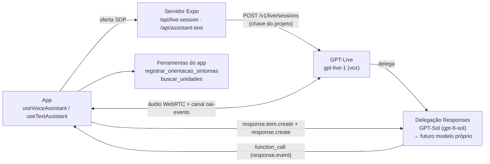
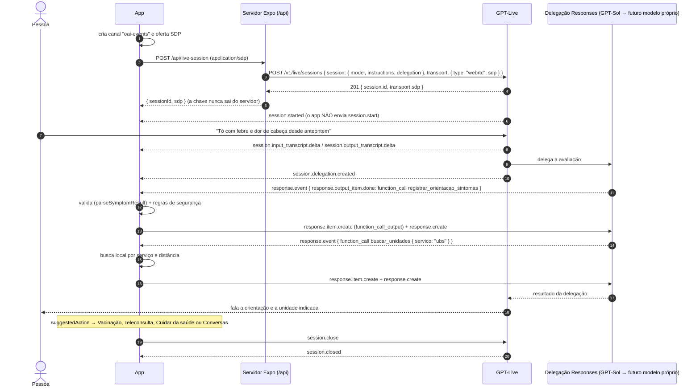

# Arquitetura do assistente (voz e texto)

O Alô Saúde é um **guia de acesso ao SUS**: ajuda a pessoa a entender qual serviço procurar, onde e como. Ele **não faz triagem clínica nem diagnóstico** (ver `docs/features.md`).

A conversa por voz acontece com o **GPT-Live** (modelo `gpt-live-1`, fala-para-fala via WebRTC) usando **delegação Responses**: o GPT-Live conversa com a pessoa e, quando precisa avaliar sintomas ou indicar serviços, delega o trabalho a um modelo de backend (hoje o **GPT-Sol**, `gpt-6-sol`). Esse backend pode pedir **ferramentas executadas pelo próprio app**.

- **voz** — `useVoiceAssistant()` (microfone + resposta falada pelo GPT-Live);
- **texto** — `useTextAssistant()` (tela Conversas). O GPT-Live não aceita texto digitado, então o chat chama a rota `/api/assistant-text`, que roda **o mesmo modelo de backend, com as mesmas instruções e ferramentas**.

Os dois hooks usam a mesma máquina de estados, a mesma transcrição e as mesmas ferramentas.

## Os 5 casos atendidos

| Caso | O que acontece | Ferramenta do app |
| --- | --- | --- |
| 1. Vacinação | Identifica a vacina, explica documentos, indica locais | `buscar_unidades` (`vacinacao`) |
| 2. Sintomas | O backend avalia a urgência e registra a avaliação estruturada | `registrar_orientacao_sintomas` → depois `buscar_unidades` |
| 3. Teleconsulta | Explica opções remotas do SUS no município | `buscar_unidades` (`teleconsulta`) |
| 4. Consulta de rotina | Explica a UBS de referência e como agendar | `buscar_unidades` (`consulta_rotina`) |
| 5. Atendimento presencial | Indica unidades pelo **serviço necessário**, depois pela distância | `buscar_unidades` |

As instruções (`src/features/voice/session-config.ts`) pedem linguagem simples, compreensão de gírias regionais, perguntas complementares só quando necessárias, honestidade sobre limitações (indicando Disque Saúde 136, app Meu SUS Digital, UBS ou Secretaria Municipal) e reconhecimento de sinais de alerta → **SAMU 192 / UPA**.

## Visão geral



## Fluxo por voz



### Endpoints e eventos usados

Documentação consultada em outubro/2026:
[WebRTC (seção GPT-Live)](https://developers.openai.com/api/docs/guides/realtime-webrtc),
[delegação](https://developers.openai.com/api/docs/guides/live-delegation),
[conversas no GPT-Live](https://developers.openai.com/api/docs/guides/live-conversations),
[Structured Outputs](https://developers.openai.com/api/docs/guides/structured-outputs).

- `POST https://api.openai.com/v1/live/sessions` (servidor, chave do projeto) → `201 { session.id, transport.sdp }`.
- Canal de dados `oai-events`; esperar `session.started`; nunca enviar `session.start`.
- Eventos tratados: `session.started`, `session.input_transcript.delta`, `session.output_transcript.delta`, `session.delegation.created`, `response.event` (despachando por `event.type` aninhado: `response.created`, `response.output_item.done`, `response.completed|failed|incomplete`), `session.input_audio.muted|unmuted`, `session.closed`, `error`.
- Comandos enviados: `response.item.create` (`function_call_output`, um para **cada** chamada pendente), `response.create` (uma vez, quando a resposta do backend terminou e todas as chamadas têm resultado — ver `createToolBatcher`), `session.input_audio.mute|unmute`, `session.close`.
- Os deltas de transcrição do GPT-Live não têm `item_id` nem evento de fim de turno: o reducer agrupa por falante e o hook marca o fim do turno após 1,2 s de silêncio (`app.turn_completed`, evento sintético do app).
- Modo texto: `POST https://api.openai.com/v1/responses` com o mesmo modelo, instruções e ferramentas, `store: false`.

## Organização do código

| Caminho | Responsabilidade |
| --- | --- |
| `src/app/api/live-session+api.ts` | Cria a sessão GPT-Live a partir da oferta SDP |
| `src/app/api/assistant-text+api.ts` | Um turno do modo texto (mesmo backend) |
| `src/app/api/analyze-symptoms+api.ts` | Caminho reservado para a delegação pelo cliente (ver abaixo) |
| `src/services/server/` | Handlers testáveis, `request-guard.ts` (origem + limite, TODO auth) |
| `src/services/symptom-model/` | `SymptomAnalyzer`, cliente GPT-Sol, schema, validação e fallback |
| `src/services/health-units/` | `HealthUnitFinder`, busca local por serviço + distância |
| `src/services/text-assistant/protocol.ts` | Contrato e validação do modo texto |
| `src/features/voice/reducer.ts` | Máquina de estados **pura** (status, transcrição, `suggestedAction`) |
| `src/features/voice/delegation.ts` | Leitura dos envelopes `response.event` e lote de resultados |
| `src/features/voice/tool-call.ts` | Execução das ferramentas do app |
| `src/features/voice/webrtc/` | Transporte GPT-Live (`react-native-webrtc` no celular, navegador na web) |
| `src/features/voice/text/` | Transporte do modo texto (traduz para os mesmos eventos do GPT-Live) |
| `src/features/voice/use-*.ts` | Hooks `useVoiceAssistant` e `useTextAssistant` |
| `src/mocks/` | GPT-Live simulado, unidades fictícias e intenções da demo |

Estados: `idle`, `connecting`, `listening`, `user_speaking`, `thinking`, `analyzing_symptoms`, `searching_units`, `assistant_speaking`, `error` (`closing` está reservado para a UI).

## Modo demonstração (sem chave)

Com `EXPO_PUBLIC_VOICE_MOCK=1` ou sem `EXPO_PUBLIC_API_URL`, o app usa um transporte simulado que emite os **mesmos eventos do GPT-Live com delegação**:

- **voz**: roteiro "febre e dor de cabeça desde anteontem" → `registrar_orientacao_sintomas` → `buscar_unidades` (UBS) → orientação falada;
- **texto**: responde ao que é digitado por palavras-chave (vacina, sintomas, teleconsulta, consulta de rotina, unidades, sinais de alerta).

As unidades em `src/mocks/health-units.ts` são **fictícias**. Ainda não há base oficial integrada; mesmo no modo real, `buscar_unidades` usa esses dados de exemplo e sempre devolve um aviso para confirmar pelos canais oficiais.

---

## ⚠️ Modelo de sintomas: substituto temporário

> **O modelo especializado de análise de sintomas treinado para o Alô Saúde AINDA NÃO EXISTE.**
> Hoje o papel dele é feito pelo **GPT-Sol** (`gpt-6-sol`), que é o **backend de delegação Responses** do GPT-Live e também o modelo do modo texto. Ele é configurado pela variável de servidor `SYMPTOM_MODEL`.

O backend avalia os sintomas e **registra a avaliação** chamando `registrar_orientacao_sintomas` (`urgency`, `orientation`, `recommendedCare`, `warningSigns`, schema estrito). O app valida com `parseSymptomResult`, aplica as regras de segurança e devolve o resultado final ao backend, que deve se basear nele. Assim a UI recebe um resultado estruturado (cartão de análise + `suggestedAction`) e a segurança não depende só do modelo.

### Como trocar pelo modelo próprio

**Opção A — delegação Responses (preferida):** se o modelo próprio for servido por uma API compatível com a Responses API (por exemplo, um fine-tune disponível na OpenAI), basta trocar `SYMPTOM_MODEL`. Nada muda no app: instruções, ferramentas, validação e testes continuam iguais.

**Opção B — delegação pelo cliente:** se o modelo não falar a Responses API, crie a sessão com `delegation: { type: "client" }`. Ao receber `session.delegation.created`, o app chama `/api/analyze-symptoms`, que usa a interface `SymptomAnalyzer`:

```ts
interface SymptomAnalyzer {
  analyze(input: SymptomInput, options?: { signal?: AbortSignal }): Promise<SymptomResult>;
}
```

Implemente `createSpecializedAnalyzer()` e passe-o em `handleAnalyzeSymptoms(request, env, { createAnalyzer })`. O resultado validado volta ao GPT-Live com `session.commentary.append` (falado) ou `session.thinking.append` (contexto). Nesse modo o app precisa montar o contexto a partir das transcrições (`session.input_transcript.delta` / `session.output_transcript.delta`). A rota, o cliente GPT-Sol e o `parseSymptomResult` já existem e têm testes; falta só o despacho no hook.

Nas duas opções a saída continua passando por `parseSymptomResult`.

### Notas de segurança

- Toda avaliação é validada: urgência, tipo de atendimento ou orientação inválidos viram o **fallback seguro** (“procure atendimento; se houver falta de ar, dor no peito ou desmaio, ligue 192”).
- Regras fixas sobre a saída do modelo: `emergencia` → sempre `samu`; `urgente` nunca vira `autocuidado`/`teleconsulta`.
- Argumentos inválidos, falha de rede ou função desconhecida sempre geram um `function_call_output` (o backend nunca fica esperando) com resultado seguro.
- Sinais de alerta estão nas instruções do GPT-Live e do backend.
- Uma sugestão de emergência (`suggestedAction.emergency`) não é substituída por outra menos urgente na mesma conversa.
- O assistente não diagnostica, não prescreve e sempre explica que não substitui um profissional. As regras ainda precisam ser validadas por profissionais de saúde antes do uso real.

## Segurança das rotas

- A **chave do projeto fica só no servidor**. Não há client secret efêmero: o app manda a oferta SDP e recebe só a resposta SDP e o id da sessão.
- `request-guard.ts`: checagem de `Origin` (`ALLOWED_ORIGINS`) e limite simples por IP em memória. Como o guia do GPT-Live alerta, **isso não autentica ninguém**. **TODO**: autenticação do usuário, autorização, limites por usuário em armazenamento compartilhado e HTTPS antes de expor publicamente.
- Validação de entrada: oferta SDP (`application/sdp`, começa com `v=`, até 64 KB), conversa do modo texto (papéis permitidos, até 60 itens de até 4.000 caracteres).

## Privacidade e LGPD

- **Sem persistência de dados de saúde**: transcrição, sintomas e resultados ficam apenas na memória da sessão (estado do hook) e são descartados ao sair. As rotas `/api` não gravam nada e respondem com `Cache-Control: no-store`; o modo texto e o cliente GPT-Sol usam `store: false`; a sessão GPT-Live usa o padrão `store: false`.
- **Chave nunca no app**; variáveis `EXPO_PUBLIC_*` vão para o bundle e nunca contêm segredos.
- **Minimização**: o assistente é instruído a não pedir nome completo, CPF ou endereço exato. A localização é opcional e usada só para calcular distâncias.
- Dados de saúde são dados pessoais sensíveis (LGPD, art. 11). Antes de produção: termo de consentimento claro, base legal definida, relatório de impacto (RIPD), avaliação da transferência internacional de dados para o provedor do modelo e política de retenção do provedor.

## Configuração

Ver `.env.example`:

- Servidor: `OPENAI_API_KEY`, `OPENAI_LIVE_MODEL` (padrão `gpt-live-1`), `SYMPTOM_MODEL` (padrão `gpt-6-sol`), `ALLOWED_ORIGINS` (opcional).
- App: `EXPO_PUBLIC_API_URL` (URL do servidor das rotas `/api`), `EXPO_PUBLIC_VOICE_MOCK` (`1` força a demo).

`react-native-webrtc` é nativo: é preciso um development build (`pnpm ios` / `pnpm android`), não funciona no Expo Go. A permissão de microfone está no `app.json` (iOS `NSMicrophoneUsageDescription`, Android `RECORD_AUDIO`).

### Pendências conhecidas

- Autenticação nas rotas `/api` (ver acima).
- Roteamento de áudio para o alto-falante no iOS (avaliar `react-native-incall-manager` ou `RTCAudioSession`).
- Localização real: `getCoordinates` é injetável no hook; falta integrar `expo-location` com consentimento.
- Base oficial de unidades (CNES / dados municipais) no lugar dos dados fictícios.
- Despacho da opção B (delegação pelo cliente) no hook, se o modelo próprio exigir.
