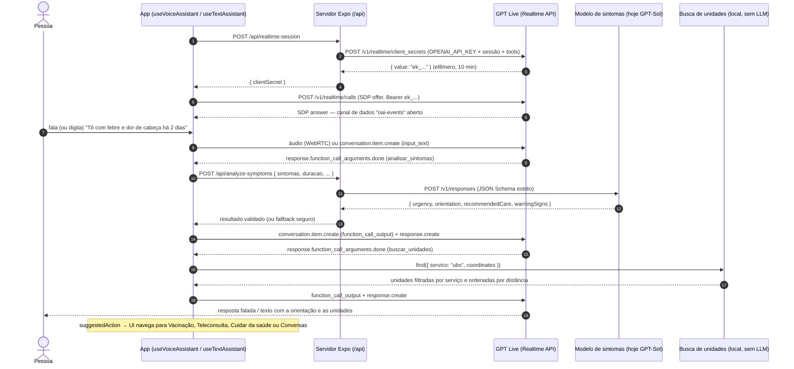

# Arquitetura do assistente (voz e texto)

O Alô Saúde é um **guia de acesso ao SUS**: ajuda a pessoa a entender qual serviço procurar, onde e como. Ele **não faz triagem clínica nem diagnóstico** (ver `docs/features.md`).

A conversa acontece com o **GPT Live**, a Realtime API da OpenAI (modelo `gpt-realtime`, fala-para-fala via WebRTC). O mesmo motor atende:

- **voz** — `useVoiceAssistant()` (microfone + resposta falada);
- **texto** — `useTextAssistant()` (tela Conversas; mesma sessão Realtime, sem microfone, respostas só em texto).

Os dois hooks usam a mesma máquina de estados, a mesma transcrição e as mesmas ferramentas.

## Os 5 casos atendidos

| Caso | O que o GPT Live faz | Ferramenta |
| --- | --- | --- |
| 1. Vacinação | Identifica a vacina, explica documentos, indica locais | `buscar_unidades` (`vacinacao`) |
| 2. Sintomas | Coleta só o essencial e orienta o nível de atendimento | `analisar_sintomas` → depois `buscar_unidades` |
| 3. Teleconsulta | Explica opções remotas do SUS no município | `buscar_unidades` (`teleconsulta`) |
| 4. Consulta de rotina | Explica a UBS de referência e como agendar | `buscar_unidades` (`consulta_rotina`) |
| 5. Atendimento presencial | Indica unidades pelo **serviço necessário**, depois pela distância | `buscar_unidades` |

As instruções da sessão (em `src/features/voice/session-config.ts`) pedem linguagem simples, compreensão de gírias regionais, perguntas complementares só quando necessárias, honestidade sobre limitações (indicando Disque Saúde 136, app Meu SUS Digital, UBS ou Secretaria Municipal) e reconhecimento de sinais de alerta → **SAMU 192 / UPA**.

## Fluxo



### Endpoints e eventos usados

Documentação consultada em outubro/2026:
[Realtime WebRTC](https://developers.openai.com/api/docs/guides/realtime-webrtc),
[client_secrets](https://developers.openai.com/api/reference/resources/realtime/subresources/client_secrets/methods/create),
[conversas e function calling](https://developers.openai.com/api/docs/guides/realtime-conversations),
[eventos do servidor](https://developers.openai.com/api/reference/resources/realtime/server-events),
[Structured Outputs](https://developers.openai.com/api/docs/guides/structured-outputs).

- `POST https://api.openai.com/v1/realtime/client_secrets` — gera o client secret efêmero (`value`).
- `POST https://api.openai.com/v1/realtime/calls` — troca de SDP (`Content-Type: application/sdp`).
- Canal de dados `oai-events`.
- Eventos tratados: `session.created`, `input_audio_buffer.speech_started|speech_stopped`, `conversation.item.input_audio_transcription.completed`, `response.created`, `response.output_audio_transcript.delta|done`, `response.output_text.delta|done`, `response.function_call_arguments.done`, `output_audio_buffer.started|stopped`, `response.done`, `error`.
- Eventos enviados: `conversation.item.create` (`function_call_output` ou `message` com `input_text`), `response.create` (no modo texto com `output_modalities: ["text"]`), `session.update` (modo texto).
- Modelo de sintomas: `POST https://api.openai.com/v1/responses` com `text.format = { type: "json_schema", strict: true }`.

## Organização do código

| Caminho | Responsabilidade |
| --- | --- |
| `src/app/api/realtime-session+api.ts` | Rota de servidor: client secret efêmero |
| `src/app/api/analyze-symptoms+api.ts` | Rota de servidor: modelo de sintomas |
| `src/services/server/` | Handlers testáveis das rotas (env e `fetch` injetáveis) |
| `src/services/symptom-model/` | Interface `SymptomAnalyzer`, cliente GPT-Sol, prompt, validação e fallback |
| `src/services/health-units/` | Interface `HealthUnitFinder`, busca local por serviço + distância |
| `src/features/voice/reducer.ts` | Máquina de estados **pura** (status, transcrição, `suggestedAction`) |
| `src/features/voice/tool-call.ts` | Executa as ferramentas e monta os eventos de resposta |
| `src/features/voice/webrtc/` | Transporte WebRTC (`react-native-webrtc` no celular, API do navegador na web) |
| `src/features/voice/use-*.ts` | Hooks `useVoiceAssistant` e `useTextAssistant` |
| `src/mocks/` | Conversa simulada, unidades fictícias e intenções da demo |

Estados da conversa: `idle`, `connecting`, `listening`, `user_speaking`, `thinking`, `analyzing_symptoms`, `searching_units`, `assistant_speaking`, `error`.

## Modo demonstração (sem chave)

Com `EXPO_PUBLIC_VOICE_MOCK=1` ou sem `EXPO_PUBLIC_API_URL`, o app usa um transporte simulado que emite os mesmos eventos da Realtime API:

- **voz**: roteiro "febre e dor de cabeça há 2 dias" → `analisar_sintomas` → orientação → `buscar_unidades` (UBS);
- **texto**: responde ao que é digitado por palavras-chave (vacina, sintomas, teleconsulta, consulta de rotina, unidades, sinais de alerta).

As unidades em `src/mocks/health-units.ts` são **fictícias**. Ainda não há base oficial integrada; mesmo no modo real, `buscar_unidades` usa esses dados de exemplo e sempre devolve um aviso para confirmar pelos canais oficiais.

---

## ⚠️ Modelo de sintomas: substituto temporário

> **O modelo especializado de análise de sintomas treinado para o Alô Saúde AINDA NÃO EXISTE.**
> Enquanto ele não fica pronto, a ferramenta `analisar_sintomas` é atendida pelo **GPT-Sol**, um modelo de uso geral, configurado pela variável de servidor `SYMPTOM_MODEL` (padrão `gpt-sol`).

O GPT-Sol só é chamado no **caso 2 (sintomas)**, e só pelo servidor.

### Como trocar pelo modelo especializado

Todo o app depende apenas da interface `SymptomAnalyzer` (`src/services/symptom-model/types.ts`):

```ts
interface SymptomAnalyzer {
  analyze(input: SymptomInput, options?: { signal?: AbortSignal }): Promise<SymptomResult>;
}
```

1. Se o novo modelo for exposto pela Responses API com o mesmo schema, basta definir `SYMPTOM_MODEL=<id-do-modelo>` no servidor.
2. Se tiver outro formato/endpoint, crie `createSpecializedAnalyzer()` implementando `SymptomAnalyzer` e passe-o em `handleAnalyzeSymptoms(request, env, { createAnalyzer })`.
3. Mantenha a saída passando por `parseSymptomResult`, que valida, aplica as regras de segurança e cai no fallback quando necessário.

O app (rota `/api/analyze-symptoms`, `handleToolCall`, reducer e telas) não precisa mudar.

### Notas de segurança

- O resultado é sempre validado: urgência, tipo de atendimento e orientação inválidos viram o **fallback seguro** (“procure atendimento; se houver falta de ar, dor no peito ou desmaio, ligue 192”).
- Regras fixas sobre a saída do modelo: `emergencia` → sempre `samu`; `urgente` nunca vira `autocuidado`/`teleconsulta`.
- Falha de rede, timeout ou argumentos inválidos da ferramenta também resultam no fallback seguro — o assistente nunca fica sem orientação.
- Sinais de alerta são tratados pelas instruções do GPT Live antes mesmo de chamar a ferramenta.
- Uma sugestão de emergência (`suggestedAction.emergency`) não é substituída por outra menos urgente na mesma conversa.
- O assistente não diagnostica, não prescreve e sempre explica que não substitui um profissional. As regras ainda precisam ser validadas por profissionais de saúde antes do uso real.

## Privacidade e LGPD

- **Chave da OpenAI só no servidor** (`OPENAI_API_KEY` nas rotas `/api`). O app recebe apenas um client secret **efêmero** (expira em 10 minutos) e nunca vê a chave real. Variáveis `EXPO_PUBLIC_*` vão para o bundle e nunca devem conter segredos.
- **Sem persistência de dados de saúde**: transcrição, sintomas e resultados ficam apenas na memória da sessão (estado do hook) e são descartados ao sair. As rotas `/api` não gravam nada e respondem com `Cache-Control: no-store`; a chamada ao modelo de sintomas usa `store: false`.
- **Minimização**: o assistente é instruído a não pedir nome completo, CPF ou endereço exato. A localização é opcional e usada só para calcular distâncias.
- Dados de saúde são dados pessoais sensíveis (LGPD, art. 11). Antes de produção: termo de consentimento claro, base legal definida, relatório de impacto (RIPD), avaliação da transferência internacional de dados para o provedor do modelo e política de retenção do provedor.

## Configuração

Ver `.env.example`:

- Servidor: `OPENAI_API_KEY`, `OPENAI_REALTIME_MODEL` (padrão `gpt-realtime`), `SYMPTOM_MODEL` (padrão `gpt-sol`).
- App: `EXPO_PUBLIC_API_URL` (URL do servidor das rotas `/api`), `EXPO_PUBLIC_VOICE_MOCK` (`1` força a demo).

`react-native-webrtc` é nativo: é preciso um development build (`pnpm ios` / `pnpm android`), não funciona no Expo Go. A permissão de microfone está configurada no `app.json` (iOS `NSMicrophoneUsageDescription`, Android `RECORD_AUDIO`).

### Pendências conhecidas

- Roteamento de áudio para o alto-falante no iOS (hoje segue o padrão do `react-native-webrtc`; avaliar `react-native-incall-manager` ou `RTCAudioSession`).
- Localização real do aparelho: `getCoordinates` é injetável no hook; falta integrar `expo-location` com consentimento.
- Base oficial de unidades (CNES / dados municipais) no lugar dos dados fictícios.
